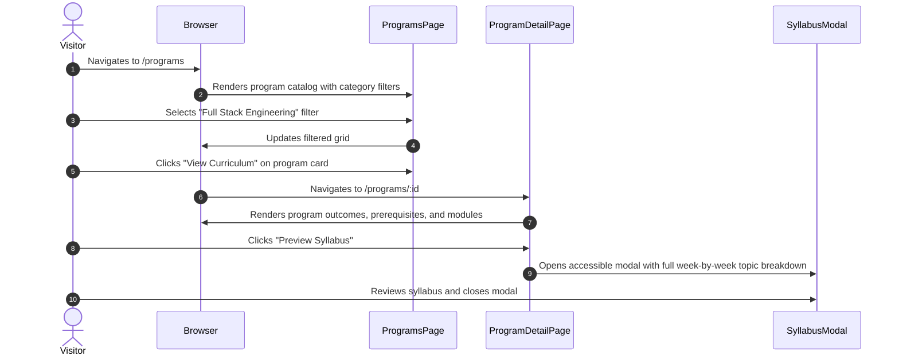
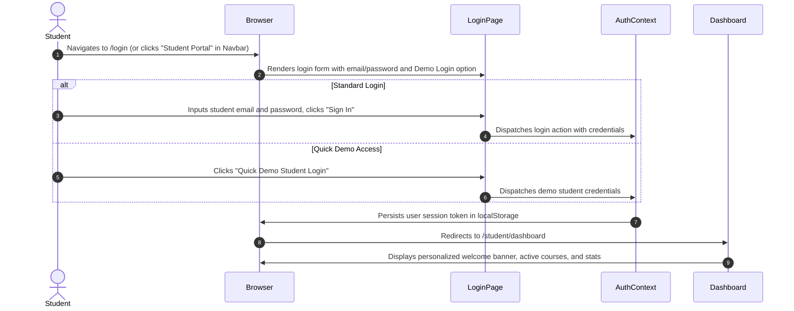
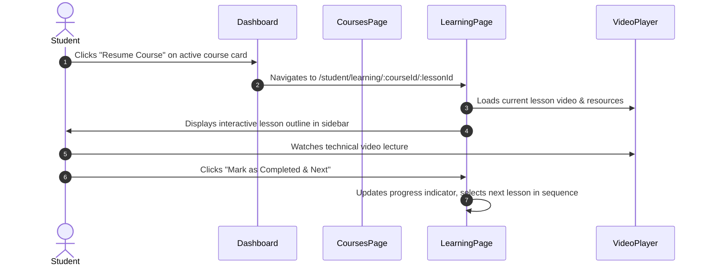
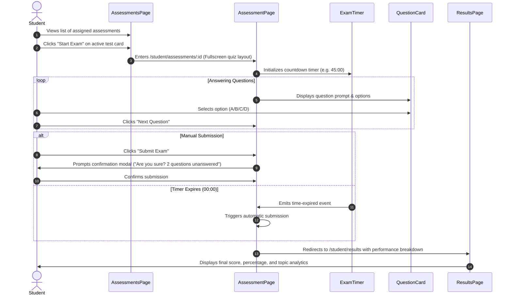
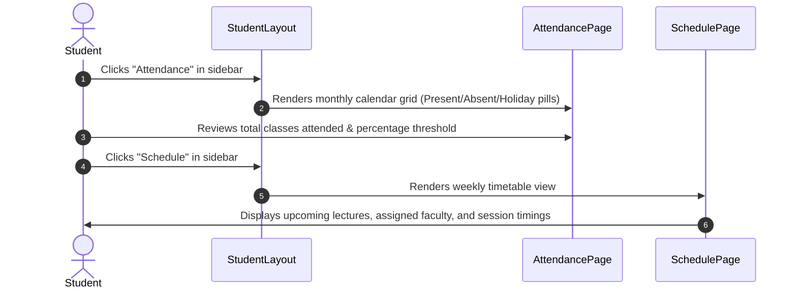

# 04 — User Flows: Shank's Code

This document outlines standard user journeys across the public platform and the authenticated student portal.

> [!NOTE]
> Each user flow is tagged with its confirmation status based on `03-FEATURE-SPEC.md`. Flows marked `REQUIRES APPROVAL` represent proposed interaction models and must receive explicit confirmation before being finalized for production implementation.

---

## Flow 1: Prospective Student Discovers a Program & Reviews Syllabus `[CONFIRMED]`

---

## Flow 2: Student Authentication & Portal Onboarding `[CONFIRMED]`

---

## Flow 3: Student Continues Learning (Course Module to Lesson Player) `[CONFIRMED]`

---

## Flow 4: Student Takes a Timed Assessment `[REQUIRES APPROVAL]`

> [!WARNING]
> This flow depends on the proposed Timed Assessment & Quiz Engine feature and is **subject to project owner approval**.

---

## Flow 5: Student Monitors Attendance & Weekly Timetable `[REQUIRES APPROVAL]`

> [!WARNING]
> This flow depends on the proposed Attendance Ledger and Schedule features and is **subject to project owner approval**.

