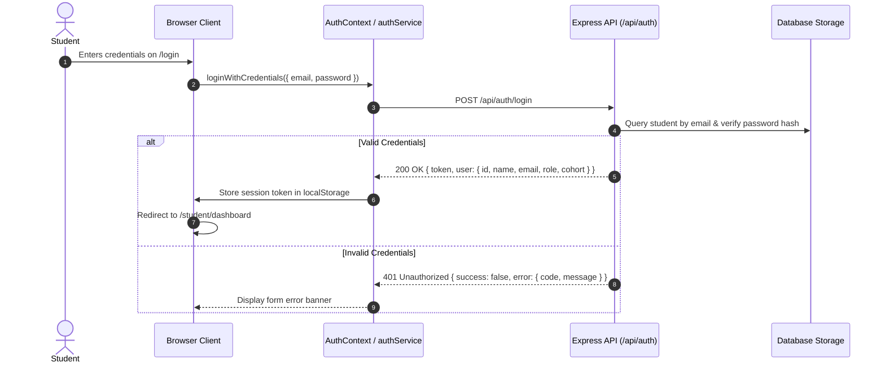

# 10 — Backend API Contract Review & Alignment: Shank's Code

This document provides the authoritative **API Contract Review** between the existing React frontend client and the future Node.js/Express REST backend for the Shank's Code platform.

> [!IMPORTANT]
> **API Confirmation Status**:
> The backend server has **NOT** been implemented yet. All API endpoints and payload schemas in this document represent the formal requirements established by the implemented frontend features.
> - **Zero endpoints are marked `CONFIRMED`** until the backend engineering team reviews, agrees to, and formally signs off on the schemas.
> - Endpoints corresponding to currently approved and implemented frontend features are designated as `PENDING BACKEND CONFIRMATION`.
> - Endpoints corresponding to unapproved or future roadmap modules are designated as `NOT CURRENTLY REQUIRED`.
> - The existing React frontend implementation represents the **source of truth** for data consumption patterns.

---

## 1. Executive Summary & Purpose

Shank's Code frontend features have been constructed incrementally using typed development placeholder models (`DEVELOPMENT_DASHBOARD_DATA`, `DEVELOPMENT_ENROLLED_COURSES`, `DEVELOPMENT_LEARNING_COURSES`).

Before backend server implementation begins in Node.js/Express, this contract review establishes:
1. Exact endpoint signatures, query parameters, and payload schemas needed by the client.
2. The authentication, course syllabus, and lesson completion workflows.
3. The boundary between confirmed core features and approval-gated features.
4. Concrete technical questions that must be resolved with the backend team.

---

## 2. Master Endpoint Inventory & Status Matrix

| # | HTTP Method | URL Path | Purpose | Consuming Frontend Feature | Current Client Implementation | Confirmation Status |
|---|---|---|---|---|---|---|
| 1 | `POST` | `/api/auth/login` | Authenticates student credentials & returns session | `features/auth` (LoginPage) | Implemented via `authService.ts` (Mock session) | **PENDING BACKEND CONFIRMATION** |
| 2 | `POST` | `/api/auth/register` | Student self-registration | `features/auth` (SignupPage) | Proposed only (`docs/03-FEATURE-SPEC.md` P-AUTH-02) | **NOT CURRENTLY REQUIRED** |
| 3 | `GET` | `/api/auth/me` | Validates session token & returns current profile | Global `AuthContext` | In-memory `localStorage` session check | **PENDING BACKEND CONFIRMATION** |
| 4 | `GET` | `/api/programs` | Retrieves public catalog of programs | `features/programs` (ProgramsPage) | Implemented via `programsData.ts` (Static catalog) | **PENDING BACKEND CONFIRMATION** |
| 5 | `GET` | `/api/programs/:id` | Retrieves single program syllabus & outcomes | `features/programs` (ProgramDetailPage) | Static catalog placeholder | **PENDING BACKEND CONFIRMATION** |
| 6 | `GET` | `/api/student/courses` | Retrieves active enrolled courses & progress | `features/student/courses` (CoursesPage) | Implemented via `mockCoursesData.ts` | **PENDING BACKEND CONFIRMATION** |
| 7 | `GET` | `/api/student/courses/:id` | Retrieves full modular syllabus for a course | `features/student/courses` (CoursesPage) | Implemented via `mockCoursesData.ts` | **PENDING BACKEND CONFIRMATION** |
| 8 | `POST` | `/api/student/courses/:courseId/lessons/:lessonId/complete` | Marks lesson completed & unlocks next lesson | `features/student/learning` (LearningPage) | Implemented via local state mutation | **PENDING BACKEND CONFIRMATION** |
| 9 | `GET` | `/api/student/assessments` | Lists assigned and completed technical quizzes | `features/student/assessments` | Unapproved module (Requires Approval) | **NOT CURRENTLY REQUIRED** |
| 10 | `GET` | `/api/student/assessments/:id` | Retrieves timed assessment questions | `features/student/assessments` | Unapproved module (Requires Approval) | **NOT CURRENTLY REQUIRED** |
| 11 | `POST` | `/api/student/assessments/:id/submit` | Submits answers; scores and records exam | `features/student/assessments` | Unapproved module (Requires Approval) | **NOT CURRENTLY REQUIRED** |
| 12 | `GET` | `/api/student/results` | Retrieves student gradebook & analytics | `features/student/results` | Unapproved module (Requires Approval) | **NOT CURRENTLY REQUIRED** |
| 13 | `GET` | `/api/student/attendance` | Retrieves monthly attendance ledger & % | `features/student/attendance` | Unapproved module (Requires Approval) | **NOT CURRENTLY REQUIRED** |
| 14 | `GET` | `/api/student/schedule` | Retrieves weekly timetable & live sessions | `features/student/schedule` | Unapproved module (Requires Approval) | **NOT CURRENTLY REQUIRED** |
| 15 | `GET` | `/api/student/notifications` | Retrieves student notification feed | `features/student/notifications` | Unapproved module (Requires Approval) | **NOT CURRENTLY REQUIRED** |
| 16 | `PATCH`| `/api/student/notifications/:id/read` | Marks notification as read | `features/student/notifications` | Unapproved module (Requires Approval) | **NOT CURRENTLY REQUIRED** |
| 17 | `GET` | `/api/student/profile` | Retrieves student profile & contacts | `features/student/profile` | Unapproved module (Requires Approval) | **NOT CURRENTLY REQUIRED** |
| 18 | `PATCH`| `/api/student/profile` | Updates student contact details | `features/student/profile` | Unapproved module (Requires Approval) | **NOT CURRENTLY REQUIRED** |

---

## 3. Endpoint-by-Endpoint Detailed Review

### A. Authentication Endpoints

#### 1. `POST /api/auth/login`
- **Purpose**: Authenticates student credentials and returns an authenticated user profile and bearer token.
- **Authentication**: Public (Unauthenticated).
- **Path Parameters**: None.
- **Query Parameters**: None.
- **Request Body**:
  ```json
  {
    "email": "student@shanks-code.com",
    "password": "SecurePassword123!"
  }
  ```
- **Response Structure (200 OK)**:
  ```json
  {
    "token": "eyJhbGciOiJIUzI1NiIsInR5cCI6IkpXVCJ9...",
    "user": {
      "id": "stu-001",
      "name": "Demo Student",
      "email": "student@shanks-code.com",
      "role": "student",
      "cohort": "Full-Stack Cohort 2026-A"
    }
  }
  ```
- **Error Response Structure**:
  ```json
  {
    "success": false,
    "error": {
      "code": "INVALID_CREDENTIALS",
      "message": "Invalid email or password provided."
    }
  }
  ```
- **Expected Status Codes**: `200 OK`, `400 Bad Request`, `401 Unauthorized`, `500 Internal Server Error`.
- **Consuming Feature**: `client/src/features/auth` (`LoginForm.tsx`, `LoginPage.tsx`).
- **Current Client Dependency**: `authService.loginWithCredentials` in `authService.ts`.
- **Backend Status**: Not Implemented.
- **Confirmation Status**: **PENDING BACKEND CONFIRMATION**.

---

#### 2. `POST /api/auth/register`
- **Purpose**: Proposed self-registration for prospective students.
- **Authentication**: Public (Unauthenticated).
- **Path Parameters**: None.
- **Query Parameters**: None.
- **Request Body**:
  ```json
  {
    "name": "Alex Mercer",
    "email": "alex@example.com",
    "password": "Password123!"
  }
  ```
- **Response Structure (201 Created)**:
  ```json
  {
    "token": "jwt-token-string",
    "user": {
      "id": "stu-002",
      "name": "Alex Mercer",
      "email": "alex@example.com",
      "role": "student"
    }
  }
  ```
- **Error Response Structure**: Standard error format (`EMAIL_ALREADY_EXISTS`, `WEAK_PASSWORD`).
- **Expected Status Codes**: `201 Created`, `400 Bad Request`, `409 Conflict`, `500 Internal Server Error`.
- **Consuming Feature**: Proposed `features/auth/pages/SignupPage.tsx` (`docs/03-FEATURE-SPEC.md` P-AUTH-02).
- **Current Client Dependency**: None. Self-registration is currently unapproved.
- **Backend Status**: Not Implemented.
- **Confirmation Status**: **NOT CURRENTLY REQUIRED**.

---

#### 3. `GET /api/auth/me`
- **Purpose**: Validates active session token and hydrates current student profile on application reload.
- **Authentication**: Protected (`Authorization: Bearer <token>`).
- **Path Parameters**: None.
- **Query Parameters**: None.
- **Request Body**: None.
- **Response Structure (200 OK)**:
  ```json
  {
    "user": {
      "id": "stu-001",
      "name": "Demo Student",
      "email": "student@shanks-code.com",
      "role": "student",
      "cohort": "Full-Stack Cohort 2026-A"
    }
  }
  ```
- **Error Response Structure**: Standard 401 Unauthorized envelope.
- **Expected Status Codes**: `200 OK`, `401 Unauthorized`, `500 Internal Server Error`.
- **Consuming Feature**: `client/src/context/AuthContext.tsx`.
- **Current Client Dependency**: Currently reads persisted JSON from `localStorage` (`shanks_code_student_session`).
- **Backend Status**: Not Implemented.
- **Confirmation Status**: **PENDING BACKEND CONFIRMATION**.

---

### B. Program Discovery Endpoints

#### 4. `GET /api/programs`
- **Purpose**: Returns the public academic catalog of training programs with optional category filtering and search.
- **Authentication**: Public (Unrestricted).
- **Path Parameters**: None.
- **Query Parameters**:
  - `category` (optional, string: e.g. `Full Stack`, `Systems & Cloud`, `Data & AI`)
  - `search` (optional, string: keyword filter)
- **Request Body**: None.
- **Response Structure (200 OK)**:
  ```json
  {
    "programs": [
      {
        "id": "prog-fsd",
        "title": "Full-Stack Software Engineering",
        "slug": "full-stack-software-engineering",
        "category": "Full Stack",
        "duration": "24 Weeks",
        "level": "Intermediate",
        "description": "Comprehensive engineering curriculum covering modern frontend, distributed backend services, and cloud deployment.",
        "skills": ["TypeScript", "React", "Node.js", "Docker", "PostgreSQL"],
        "modulesCount": 6
      }
    ]
  }
  ```
- **Error Response Structure**: Standard error envelope.
- **Expected Status Codes**: `200 OK`, `500 Internal Server Error`.
- **Consuming Feature**: `client/src/features/programs/pages/ProgramsPage.tsx`.
- **Current Client Dependency**: Static dataset `DEVELOPMENT_PROGRAMS` in `programsData.ts`.
- **Backend Status**: Not Implemented.
- **Confirmation Status**: **PENDING BACKEND CONFIRMATION**.

---

#### 5. `GET /api/programs/:id`
- **Purpose**: Returns complete curriculum breakdown, outcomes, prerequisites, and syllabus schedule for a specific program.
- **Authentication**: Public (Unrestricted).
- **Path Parameters**:
  - `id` (string: Program identifier or slug, e.g. `prog-fsd`).
- **Query Parameters**: None.
- **Request Body**: None.
- **Response Structure (200 OK)**:
  ```json
  {
    "id": "prog-fsd",
    "title": "Full-Stack Software Engineering",
    "description": "Comprehensive engineering curriculum...",
    "category": "Full Stack",
    "duration": "24 Weeks",
    "level": "Intermediate",
    "prerequisites": ["Basic programming knowledge", "Git fundamentals"],
    "careerOutcomes": ["Full Stack Engineer", "Backend Developer"],
    "modules": [
      {
        "id": "mod-01",
        "title": "Module 1: Modern JavaScript & TypeScript Foundations",
        "duration": "4 Weeks",
        "topics": ["Types & Generics", "Async & Promises", "ESM Bundling"]
      }
    ]
  }
  ```
- **Error Response Structure**: `404 Not Found` when ID does not match.
- **Expected Status Codes**: `200 OK`, `404 Not Found`, `500 Internal Server Error`.
- **Consuming Feature**: Proposed `ProgramDetailPage` / `SyllabusModal` (`docs/02-PAGE-MAP.md`).
- **Current Client Dependency**: Static catalog items.
- **Backend Status**: Not Implemented.
- **Confirmation Status**: **PENDING BACKEND CONFIRMATION**.

---

### C. Student Enrolled Courses Endpoints

#### 6. `GET /api/student/courses`
- **Purpose**: Returns the list of active enrolled courses for the authenticated student, including high-level progress percentages and module counts.
- **Authentication**: Protected (`Authorization: Bearer <token>`).
- **Path Parameters**: None.
- **Query Parameters**: None.
- **Request Body**: None.
- **Response Structure (200 OK)**:
  ```json
  {
    "courses": [
      {
        "id": "dev-course-01",
        "title": "Demo Course 1: Full-Stack Foundations",
        "description": "Master modern component architecture, state management patterns, and full-stack integration workflows.",
        "category": "Full Stack",
        "progressPercentage": 50,
        "completedLessons": 4,
        "totalLessons": 8,
        "modulesCount": 3
      },
      {
        "id": "dev-course-02",
        "title": "Demo Course 2: Backend Services & APIs",
        "description": "Design robust RESTful services, middleware pipelines, and scalable backend service foundations.",
        "category": "Systems & Cloud",
        "progressPercentage": 20,
        "completedLessons": 1,
        "totalLessons": 5,
        "modulesCount": 2
      }
    ]
  }
  ```
- **Error Response Structure**: `401 Unauthorized`, `500 Internal Server Error`.
- **Expected Status Codes**: `200 OK`, `401 Unauthorized`, `500 Internal Server Error`.
- **Consuming Feature**: `client/src/features/student/dashboard` (`StudentDashboardPage.tsx`) & `client/src/features/student/courses` (`CoursesPage.tsx`).
- **Current Client Dependency**: `DEVELOPMENT_ENROLLED_COURSES` in `mockCoursesData.ts`.
- **Backend Status**: Not Implemented.
- **Confirmation Status**: **PENDING BACKEND CONFIRMATION**.

---

#### 7. `GET /api/student/courses/:id`
- **Purpose**: Returns complete course syllabus hierarchy (modules, lessons, durations, completion statuses) for an enrolled course.
- **Authentication**: Protected (`Authorization: Bearer <token>`).
- **Path Parameters**:
  - `id` (string: Course identifier, e.g. `dev-course-01`).
- **Query Parameters**: None.
- **Request Body**: None.
- **Response Structure (200 OK)**:
  ```json
  {
    "course": {
      "id": "dev-course-01",
      "title": "Demo Course 1: Full-Stack Foundations",
      "description": "Master modern component architecture...",
      "category": "Full Stack",
      "progressPercentage": 50,
      "modules": [
        {
          "id": "mod-01-01",
          "title": "Module 1: Modern JavaScript & TypeScript Foundations",
          "description": "Core language semantics and async programming.",
          "lessons": [
            {
              "id": "les-01-01",
              "title": "TypeScript Type System & Interface Design",
              "status": "completed",
              "duration": "25 min"
            },
            {
              "id": "les-01-02",
              "title": "Asynchronous Programming & Promise Pipelines",
              "status": "completed",
              "duration": "30 min"
            },
            {
              "id": "les-01-03",
              "title": "Modular Architecture & Modern Bundling",
              "status": "completed",
              "duration": "20 min"
            }
          ]
        },
        {
          "id": "mod-01-02",
          "title": "Module 2: Component Architecture & State Management",
          "description": "Component lifecycle and predictable stores.",
          "lessons": [
            {
              "id": "les-02-01",
              "title": "Component Lifecycle & Declarative State",
              "status": "completed",
              "duration": "35 min"
            },
            {
              "id": "les-02-02",
              "title": "Context API & Global State Containers",
              "status": "in-progress",
              "duration": "40 min"
            },
            {
              "id": "les-02-03",
              "title": "Custom Hooks & Reusable Logic Extraction",
              "status": "locked",
              "duration": "30 min"
            }
          ]
        }
      ]
    }
  }
  ```
- **Error Response Structure**: `401 Unauthorized`, `403 Forbidden` (if student not enrolled in course), `404 Not Found`.
- **Expected Status Codes**: `200 OK`, `401 Unauthorized`, `403 Forbidden`, `404 Not Found`, `500 Internal Server Error`.
- **Consuming Feature**: `client/src/features/student/courses` (`CoursesPage.tsx`, `EnrolledCourseCard.tsx`).
- **Current Client Dependency**: `DEVELOPMENT_ENROLLED_COURSES` in `mockCoursesData.ts`.
- **Backend Status**: Not Implemented.
- **Confirmation Status**: **PENDING BACKEND CONFIRMATION**.

---

### D. Lesson Viewing & Completion Endpoints

#### 8. `POST /api/student/courses/:courseId/lessons/:lessonId/complete`
- **Purpose**: Records completion of a specific lesson, recalculates overall course progress, and automatically unlocks the immediate next lesson in sequence.
- **Authentication**: Protected (`Authorization: Bearer <token>`).
- **Path Parameters**:
  - `courseId` (string: Course identifier).
  - `lessonId` (string: Lesson identifier to mark complete).
- **Query Parameters**: None.
- **Request Body**:
  ```json
  {
    "completedAt": "2026-09-24T08:00:00Z"
  }
  ```
- **Response Structure (200 OK)**:
  ```json
  {
    "success": true,
    "completedLessonId": "les-02-02",
    "status": "completed",
    "nextLessonId": "les-02-03",
    "nextLessonStatus": "in-progress",
    "updatedCourseProgress": {
      "completedCount": 5,
      "totalCount": 8,
      "percentage": 63
    }
  }
  ```
- **Error Response Structure**:
  ```json
  {
    "success": false,
    "error": {
      "code": "LESSON_NOT_UNLOCKED",
      "message": "Cannot complete a lesson that has not been unlocked."
    }
  }
  ```
- **Expected Status Codes**: `200 OK`, `400 Bad Request`, `401 Unauthorized`, `404 Not Found`, `500 Internal Server Error`.
- **Consuming Feature**: `client/src/features/student/learning` (`LearningPage.tsx`, `LessonHeader.tsx`).
- **Current Client Dependency**: Implemented in local React component state in `LearningPage.tsx`.
- **Backend Status**: Not Implemented.
- **Confirmation Status**: **PENDING BACKEND CONFIRMATION**.

---

### E. Approval-Gated & Future Modules (Proposed Only)

#### 9. `GET /api/student/assessments`
- **Purpose**: Lists assigned, upcoming, and submitted quizzes/exams.
- **Authentication**: Protected (`Authorization: Bearer <token>`).
- **Status**: **NOT CURRENTLY REQUIRED** (`docs/03-FEATURE-SPEC.md` P-STU-04 is unapproved).

#### 10. `GET /api/student/assessments/:id`
- **Purpose**: Returns questions and options for a timed exam (excluding answers).
- **Authentication**: Protected (`Authorization: Bearer <token>`).
- **Status**: **NOT CURRENTLY REQUIRED** (Approval-gated).

#### 11. `POST /api/student/assessments/:id/submit`
- **Purpose**: Submits student quiz answers and computes final grade.
- **Authentication**: Protected (`Authorization: Bearer <token>`).
- **Status**: **NOT CURRENTLY REQUIRED** (Approval-gated).

#### 12. `GET /api/student/results`
- **Purpose**: Returns gradebook history, pass/fail statuses, and performance trends.
- **Authentication**: Protected (`Authorization: Bearer <token>`).
- **Status**: **NOT CURRENTLY REQUIRED** (Approval-gated).

#### 13. `GET /api/student/attendance`
- **Purpose**: Returns monthly attendance ledger, calendar markers, and percentage.
- **Authentication**: Protected (`Authorization: Bearer <token>`).
- **Status**: **NOT CURRENTLY REQUIRED** (Approval-gated).

#### 14. `GET /api/student/schedule`
- **Purpose**: Returns weekly class timetable and live lecture calendar.
- **Authentication**: Protected (`Authorization: Bearer <token>`).
- **Status**: **NOT CURRENTLY REQUIRED** (Approval-gated).

#### 15. `GET /api/student/notifications`
- **Purpose**: Returns system announcements and academic alerts.
- **Authentication**: Protected (`Authorization: Bearer <token>`).
- **Status**: **NOT CURRENTLY REQUIRED** (Approval-gated).

#### 16. `PATCH /api/student/notifications/:id/read`
- **Purpose**: Marks notification as read.
- **Authentication**: Protected (`Authorization: Bearer <token>`).
- **Status**: **NOT CURRENTLY REQUIRED** (Approval-gated).

#### 17. `GET /api/student/profile`
- **Purpose**: Returns personal student information, contact info, and cohort.
- **Authentication**: Protected (`Authorization: Bearer <token>`).
- **Status**: **NOT CURRENTLY REQUIRED** (Approval-gated).

#### 18. `PATCH /api/student/profile`
- **Purpose**: Updates student phone, emergency contact, or address.
- **Authentication**: Protected (`Authorization: Bearer <token>`).
- **Status**: **NOT CURRENTLY REQUIRED** (Approval-gated).

---

## 4. Authentication Contract

### A. Intended Authentication Flow



### B. Required Identity Fields
The backend response must provide the exact fields expected by `AuthUser` in `client/src/features/auth/types.ts`:
```ts
export interface AuthUser {
  id: string;        // Unique student identifier (e.g. "stu-001")
  name: string;      // Full display name (e.g. "Demo Student")
  email: string;     // Student email address
  role: 'student';   // Must be strictly 'student' (no admin/instructor roles invented)
  cohort?: string;   // Optional enrolled cohort label (e.g. "Full-Stack 2026-A")
  avatar?: string;   // Optional avatar URL
}
```

### C. Security & Transport Requirements
1. **No Password Storage**: Passwords must **never** be stored, cached, or logged by the client.
2. **Token Format**: Standard signed JWT (`Bearer <token>`) passed via HTTP header:
   ```http
   Authorization: Bearer <jwt-token>
   ```
3. **Session Expiration (401 Handling)**:
   - When an API request returns `401 Unauthorized`, the client intercepts the response, invokes `authService.clearSession()`, and redirects the student to `/login?session_expired=true`.

---

## 5. Course Data Contract

### A. Hierarchy Model
The frontend UI enforces a clean three-tier academic hierarchy:
```
Course
 ├── Module 1
 │    ├── Lesson 1 (status: completed | in-progress | locked)
 │    ├── Lesson 2
 │    └── Lesson 3
 └── Module 2
      ├── Lesson 1
      └── Lesson 2
```

### B. Lesson Status Invariants
Every lesson in the curriculum must possess exactly one of three validated statuses:
1. `completed`: Student has completed the lesson.
2. `in-progress`: Currently unlocked and active for consumption.
3. `locked`: Inaccessible until prerequisite/preceding lessons are finished.

### C. Progress Calculation Standard
Progress is clamped between `0` and `100`:
$$\text{Progress \%} = \operatorname{clamp}\left(\operatorname{round}\left(\frac{\text{Completed Lessons Count}}{\text{Total Lessons Count}} \times 100\right), 0, 100\right)$$

The backend API may return precomputed progress, but it must strictly match this mathematical definition to ensure visual consistency across the dashboard progress meter, enrolled courses cards, and syllabus lists.

---

## 6. Learning & Lesson Viewing Contract

When the student navigates to `/student/learning/:courseId/:lessonId`, the client requires:
1. **Course & Module Context**: Course title, category, module title, module sequence number.
2. **Video Stream Metadata**: Video duration (minutes and seconds), stream URL / CDN poster.
3. **Curriculum Material**:
   - `summary`: Concise 1-2 sentence description of lesson objective.
   - `keyTakeaways`: Array of bulleted engineering principles (`string[]`).
   - `notes`: Markdown or structured text with detailed lecture content.
   - `codeSnippet`: Optional reference code object `{ language: string, code: string }`.
4. **Sequential Navigation Metadata**:
   - `previousLessonId`: ID of immediately preceding lesson (or `null` if first lesson).
   - `nextLessonId`: ID of immediately subsequent lesson (or `null` if final lesson).

---

## 7. Lesson Completion Contract

### State Transition Workflow

```
[Current Lesson: in-progress]
             │
             ▼
Student clicks "Mark as Completed & Next"
             │
             ▼
POST /api/student/courses/:courseId/lessons/:lessonId/complete
             │
             ▼
Backend Transaction:
  1. Set current lesson status = "completed"
  2. If next lesson was "locked", set next lesson status = "in-progress"
  3. Recalculate course overall completion percentage
             │
             ▼
Response (200 OK):
  {
    "completedLessonId": "...",
    "nextLessonId": "...",
    "nextLessonStatus": "in-progress",
    "updatedCourseProgress": { "completedCount": X, "totalCount": Y, "percentage": Z }
  }
             │
             ▼
Frontend State Update:
  1. Updates local course playlist icons
  2. Advances viewport to next lesson player
  3. Renders completion feedback banner
```

---

## 8. Mock vs. Live API Execution Architecture

The client application includes an environment-driven API switching mechanism defined in `client/.env`:

```env
VITE_API_MODE=mock
VITE_API_BASE_URL=http://localhost:5000/api
```

### Execution Policies:
1. **Mock Mode (`VITE_API_MODE=mock`)**:
   - Client resolves typed development data directly from local datasets (`mockCoursesData.ts`, `mockLearningData.ts`, `authService.ts`).
   - Latency simulation is applied (150–350ms) to model real network characteristics.
2. **Live Mode (`VITE_API_MODE=live`)**:
   - Client makes `fetch` requests directly to `VITE_API_BASE_URL`.
   - Injects `Authorization: Bearer <token>` from active session storage.
3. **Zero Silent Fallback Policy**:
   - **Crucial Rule**: If a network request fails in live mode (server offline, 500 error, network timeout), the application **MUST** display an explicit error alert (`ErrorState`).
   - The application **MUST NEVER** silently drop back to mock data upon a failed live network request.

---

## 9. Proposed Standard Error Response Contract

To ensure consistent exception handling across all endpoints, the following unified error envelope is proposed for backend adoption:

```json
{
  "success": false,
  "error": {
    "code": "STRING_ERROR_CODE",
    "message": "Human-readable explanation suitable for display.",
    "details": [
      {
        "field": "email",
        "issue": "Invalid email address format."
      }
    ]
  }
}
```

> [!NOTE]
> *Status: PROPOSED — REQUIRES BACKEND CONFIRMATION.*

### Standard HTTP Status Codes Catalog

| HTTP Status | Semantics | Typical Scenario |
|---|---|---|
| `200 OK` | Success | Successful GET, successful status toggle |
| `201 Created` | Created | Successful resource creation (registration, submission) |
| `400 Bad Request` | Client Error | Missing required fields, malformed JSON syntax |
| `401 Unauthorized` | Auth Required | Missing, invalid, or expired JWT bearer token |
| `403 Forbidden` | Access Denied | Student token is valid, but student is not enrolled in course |
| `404 Not Found` | Not Found | Requested course ID or lesson ID does not exist |
| `409 Conflict` | Conflict | Duplicate resource (e.g. email already registered) |
| `422 Unprocessable`| Validation Failure | Payload syntax is valid JSON, but business validation failed |
| `500 Server Error` | Internal Failure | Unhandled backend database or server exception |

---

## 10. Frontend / Backend Architectural Responsibility Split

| Responsibility Area | Frontend Client | Node.js / Express Backend |
|---|---|---|
| **User Interface & Aesthetics** | Light-First Design System, layout, typography, components, responsive breakpoints | Zero UI logic. Returns pure JSON payloads. |
| **Routing & Guards** | React Router DOM client routing, `ProtectedRoute`, URL parameters | Express route handling, path parameter validation, 404 handler |
| **Authentication Transport** | Reads/stores token in `localStorage`, attaches `Bearer` header | Generates signed JWTs, verifies cryptographic signature, checks expiration |
| **Authorization Boundaries** | Renders view only if `isAuthenticated`; redirects guests to `/login` | Verifies student owns course enrollment before returning syllabus data |
| **Curriculum & Lessons** | Renders video player frame, tabs, playlist sidebar, status icons | Stores lesson catalog in database, enforces sequential unlocking rules |
| **Lesson Completion** | Dispatches "Mark as Completed" trigger, handles UI transition | Atomically persists completion record, recalculates aggregate student progress |
| **Validation** | Client-side form validation (email regex, required fields) | Authoritative schema validation, sanitization, SQL/NoSQL injection defense |
| **State Handling** | Loading spinners, skeletons, error alerts, empty state cards | Standardized HTTP response codes and typed JSON error envelopes |

---

## 11. Scope Classification: Confirmed vs. Approval-Gated

In accordance with `docs/03-FEATURE-SPEC.md` and `docs/08-AGENT-RULES.md`:

### Confirmed Core Scope (Approved for API Contract Finalization)
- **F-PUB-01**: Program Discovery & Catalog (`/api/programs`, `/api/programs/:id`)
- **F-AUTH-01**: Student Login & Session Verification (`/api/auth/login`, `/api/auth/me`)
- **F-STU-01**: Student Dashboard (`/api/student/courses`)
- **F-STU-02**: Enrolled Courses & Syllabus Navigation (`/api/student/courses`, `/api/student/courses/:id`)
- **F-STU-03**: Lesson Environment & Completion Trigger (`/api/student/courses/:courseId/lessons/:lessonId/complete`)

### Approval-Gated Proposed Scope (NOT Currently Required)
The following endpoints must **not** be implemented in backend phase 1 without explicit stakeholder sign-off:
- `P-AUTH-02`: Student Self-Signup (`/api/auth/register`)
- `P-STU-04`: Assessments & Timed Examination (`/api/student/assessments`, `/api/student/assessments/:id/submit`)
- `P-STU-05`: Assessment Results & Performance Analytics (`/api/student/results`)
- `P-STU-06`: Attendance Ledger & Monthly Calendar (`/api/student/attendance`)
- `P-STU-07`: Class Timetable & Lecture Schedule (`/api/student/schedule`)
- `P-STU-08`: Notifications Feed (`/api/student/notifications`)
- `P-STU-09`: Student Profile View & Edit (`/api/student/profile`)
- **Unapproved Additions**: Payments, coupons, automated certificates, CMS workflows, leave tracking, predictive analytics.

---

## 12. Open Questions for Backend Team

The following concrete technical questions must be formally addressed by the backend engineering team before starting backend implementation:

1. **Authentication Transport**: Will authentication tokens be delivered via `Authorization: Bearer <JWT>` header, or does the team prefer `httpOnly`, `SameSite=Strict` secure session cookies?
2. **Login Response Schema**: Does the backend agree to return the authenticated `user` record (`id`, `name`, `email`, `role`, `cohort`) directly within the login response payload?
3. **Student Identifier Format**: What ID format will be used for students, courses, modules, and lessons (e.g., UUID v4, MongoDB `ObjectId` hex strings, or prefixed slugs like `stu-001`, `crs-001`)?
4. **Course & Syllabus Schema**: Can the backend provide the full modular course hierarchy (Modules + Lessons + Completion status) in a single `GET /api/student/courses/:id` query, or will modules and lessons require separate sub-resource queries?
5. **Lesson Completion Response**: Does the backend agree to return both the `nextLessonId` and the `updatedCourseProgress` percentage inside the `POST .../complete` response to avoid requiring a separate refetch of the entire course object?
6. **Progress Persistence**: Will course progress percentages be computed dynamically on read from completed lesson join tables, or stored as a denormalized cache on the enrollment record?
7. **Video Media Delivery**: How will lesson video streams be delivered to the client (e.g., direct HLS `.m3u8` playlist URLs, presigned S3/Cloud Storage URLs, or third-party video host iframe embed IDs)?
8. **Error Envelope Adoption**: Does the backend team accept the proposed `{ success: false, error: { code, message, details } }` standard envelope for all 4xx and 5xx responses?
9. **API Versioning Strategy**: Will endpoints be versioned via URL prefix (e.g. `/api/v1/...`) or unversioned `/api/...` as currently documented?
10. **Confirmation Sign-Off**: Can the backend team review and formally sign off on the 5 confirmed core endpoints (`POST /api/auth/login`, `GET /api/auth/me`, `GET /api/programs`, `GET /api/student/courses`, `POST .../complete`) to unblock live API service development?
